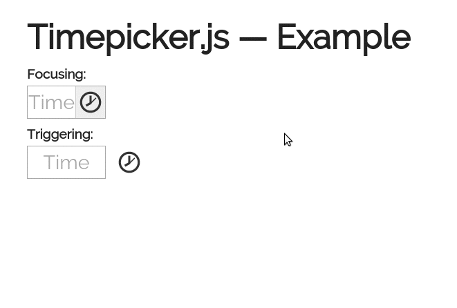

# TimePicker.js


A lightweight, customizable, TimePicker.



### Demo

[JSFiddle](https://jsfiddle.net/jonataswalker/fgyk86on/)
[StackBlitz](https://stackblitz.com/edit/jonataswalker-timepicker?file=index.js)

## How to use it?

##### &#8594; [NPM](https://www.npmjs.com/package/timepicker.js)

```shell
npm i timepicker.js
```

Installing with npm needs Node.js 22, 24 or 26 (the LTS lines) and npm 10 or higher.

##### &#8594; CDN Hosted - [jsDelivr](http://www.jsdelivr.com/projects/timepicker.js)

Load:

```HTML
<script src="https://cdn.jsdelivr.net/npm/timepicker.js/dist/timepicker.iife.js"></script>
```

##### Instantiate with some options and listen to changes

```javascript
const timepicker = new TimePicker('#click-trigger', {
    theme: 'dark',
    lang: 'pt',
})
timepicker.on('change', (evt) => {
    console.log(evt)

    // {
    //     hour: string;
    //     minute: string;
    //     element: HTMLElement;
    // }
})
```

# API

## Constructor

#### `new TimePicker(target, options)`

###### `target` can be:

`{String|Element}` String or DOM node.

A picker binds to the element that exists when it is created. To use one with an input you add later, create the picker after the input is in the DOM.

Replacing that input binds nothing new. `container.innerHTML += '…'` does replace it, because it rebuilds every child of `container`. The picker stays attached to the old, detached element, and the new input won't open it. Add markup with `container.insertAdjacentHTML('beforeend', '…')` or `container.append(…)` instead, which keeps the existing inputs. Or create a new picker for the new element.

###### `options` is an object with the following possible properties:

-   `theme`: `'dark'`; Theme color
-   `lang`: `'en'`; Header language

## Methods

#### timepicker.show()

To be used programatically. Same for `hide()`.

All targets passed to the constructor will be shown.

#### timepicker.hide()

## Events

```javascript
timepicker.on('open', function (evt) {});

timepicker.on('close', function (evt) {});

timepicker.on('change', function (evt) {});
```

## Themes

-   dark
-   red
-   pink
-   purple
-   deep-purple
-   indigo
-   blue
-   light-blue
-   cyan
-   teal
-   green
-   light-green
-   lime
-   yellow
-   amber
-   orange
-   deep-orange
-   brown
-   blue-grey


## Sponsor

If timepicker.js is useful to you, you can [sponsor its maintenance on GitHub](https://github.com/sponsors/jonataswalker).
